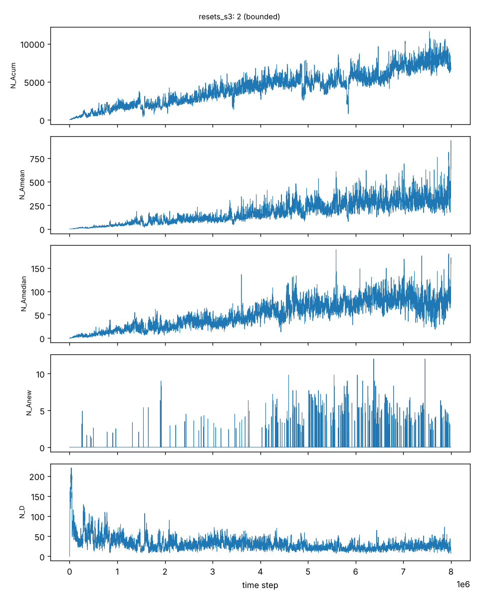
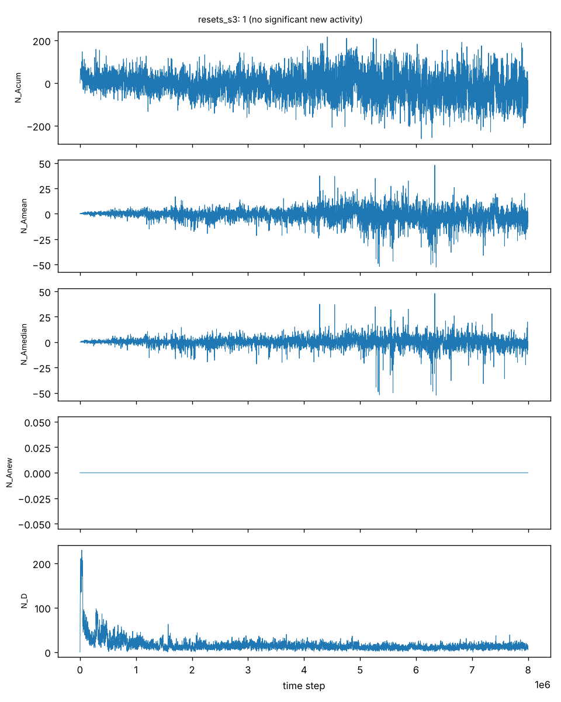

# M1 Results: Evolutionary Activity in the Geb Port (to 8M steps)

## Summary
Five independent runs of the C++20 Geb port (seeds 1-5) were analysed with Channon's
component-normalised activity test (GPEM 2006, sections 8-9), using the paper's
component class: production-rule predecessor plus link bits. Each run also carried a
null control: an independent second reset shadow, analysed as if it were the real run.

1. In every run, normalised median activity grew while the run was evolving:
   - from about 17-19 at 1M steps to 89, 106 and 99 at 8M steps (seeds 2, 3, 5).

   Diversity stayed bounded (about 20-40 components after the initial transient).
   Normalised new activity stayed positive throughout.
2. Every null control stayed near zero. Its normalised median was between -5 and +4 at
   every milestone, and it had essentially no adaptive new activity (at most 0.075% of
   snapshots).
3. Two of five seeds stagnated:
   - seed 1 at 2.80M steps;
   - seed 4 at 6.50M steps.

   In each, a single killing population stopped reproducing. Channon reports the same
   outcome in some of his runs (GPEM sections 6.4 and 10). These runs are analysed up to
   their last birth.
4. The strict Table I classification rule defined below gives results that depend on
   run length. It also gives one false positive: the seed-5 null at 8M (details
   below). Effect sizes and smoothed trajectories are the more reliable evidence.

This reproduces, qualitatively, Channon's class 3b result (unbounded evolutionary
activity with bounded diversity) and adds an independent null control. "Unbounded"
cannot be proven on finite data. What the data show is sustained, non-saturating growth
over 8M steps in the real runs and none in the nulls.

## Setup
- Simulator: `src/geb`, byte-exact with Geb v08b3 (`tests/golden`), 20x20 world,
  20-neuron limit, reset-shadow variant, snapshots every 1000 steps.
- Command: `oee_geb_resets -seed S -stats -rulestat -second-shadow -presence presence`.
  Runs were supervised with checkpoint/resume (`tools/supervise_runs.sh`). Resumed
  runs are byte-identical to uninterrupted ones (`tests/check_resume.sh`).
- Performance: optimisations made during the runs (bit-parallel rule decoding and
  others) were verified byte-identical before deployment, by fuzzing against the
  reference implementation and by A/B runs from late-stage checkpoints.
- Analysis: `tools/activity/report.py`. Activity is counted by presence, in snapshot
  units, with isolated-occurrence screening. A run is truncated at its last birth if
  births stop for 100k steps.
- Null: `-second-shadow` runs an independent random-selection shadow on its own RNG
  stream, reset to the real population at every snapshot like the first shadow. It does
  not alter the real run.

## Smoothed trajectories (predecessor + link bits)
Normalised median activity, averaged over +/-50 snapshots around each milestone.

| seed | population | 1M | 2M | 4M | 6M | 8M | new activity >0 (2nd half) | stagnated at |
|---|---|---|---|---|---|---|---|---|
| 1 | real | 17 | 27 | - | - | - | 0.24 | 2,799,900 |
| 1 | null | 2 | 1 | - | - | - | 0.00 | |
| 2 | real | 17 | 36 | 52 | 58 | 89 | 0.06 | - |
| 2 | null | 0 | -2 | -1 | -2 | -5 | 0.00 | |
| 3 | real | 18 | 23 | 56 | 72 | 106 | 0.06 | - |
| 3 | null | 0 | -2 | 0 | 1 | -2 | 0.00 | |
| 4 | real | 17 | 30 | 45 | 20 | - | 0.06 | 6,497,300 |
| 4 | null | 1 | 1 | 1 | 0 | - | 0.00 | |
| 5 | real | 19 | 32 | 57 | 69 | 99 | 0.07 | - |
| 5 | null | 1 | 0 | 1 | 2 | 4 | 0.00075 | |

Seed 4's decline from 45 to 20 precedes its stagnation: the population collapsed
before freezing. Seeds 2, 3 and 5 completed 8M steps with live populations.

## Strict classification rule (fixed before the runs; not re-tuned)
A statistic counts as unbounded when all three hold:
- Mann-Kendall z > 2.58 on 20-snapshot block means over the second half;
- positive Theil-Sen slope over the second half;
- positive Theil-Sen slope over the last quarter.

Class 3b also requires positive new activity and bounded diversity.

| seed | 1M | 2M | 4M | 6M | final |
|---|---|---|---|---|---|
| 1 | 3b | 3b | 3b (to 2.8M) | | 3b (to 2.8M) |
| 2 | 2 | 3b | 3b | 2 | 3b (8M) |
| 3 | 3b | 2 | 3b | 3b | 2 (8M) |
| 4 | | 3b | 3b | 3b | 2 (to 6.5M) |
| 5 | | 3b | 3b | 3b | 3b (8M) |
| nulls | 1-2 | 1-2 | 1-2 | 1-2 | 1-2, except seed-5 null: 3b (8M); rule grouping: 3a in two nulls |

The changes between checks have three causes:
- **Seeds 2 and 3.** The last-quarter slope criterion responds to multi-million-step
  plateaus that are later followed by renewed growth: for both seeds, the median went
  from 58 to 89 and from 72 to 106 between 6M and 8M.
- **Seed 5 at 6.9M ("3a").** This came from a small upward drift in diversity, which
  stays at about 30. At 8M it is 3b.
- **Seed-5 null at 8M (false positive).** Its median drifted from 1 to 4 over 8M steps
  (Mann-Kendall z 3.83, slope 0.34 per 1e6 steps), and it had positive new activity in
  3 of about 4000 second-half snapshots. The rule has no minimum effect size, so a
  slow drift in a null can pass it. For comparison, the seed-5 real run has slope 15.3
  per 1e6 steps and new activity in 7% of snapshots. A next version of the test should
  compare real and null directly: effect size, or a paired test against the
  null-control distribution.
- **Seed 4.** It reflects its pre-stagnation decline.

The rule is reported as fixed rather than adjusted after seeing the data. Full table,
including the whole-rule grouping: [results/m1/summary_final.md](results/m1/summary_final.md).

## Original (non-reset) Bedau-Packard test
- Only seed 1 was run with the independent shadow.
- For the same seed the real trajectory is identical in both variants: the variants
  consume the RNG stream identically. So this run also stagnated at 2.80M steps.
- Classified 2 at 1.3M steps, 3b at 2M steps, and 2 when truncated at 2.8M steps.
- One stagnating seed is insufficient to evaluate this variant.

## Observations and caveats
1. **Component class matters.** With whole rules as components (what Geb's rulestat
   records), all real runs are class 2. This matches Channon's reason for using
   predecessor plus link bits: neutral variation in successors fragments rule identity.
2. **Stagnation rate.** 2 of 5 seeds stagnated. Channon reports 5 of 20 runs as
   extinct or stagnated. Small populations (at most 400) make this likely.
3. **Population and genotype size.** Mean genotype length grows without bound (about
   15,000 genes at 6.5M steps).
4. **Detection limit.** Activity is measured by presence at 1000-step snapshots.
   Shorter-lived components are invisible to the test.

## Next
- Replace the per-run trend rule with a real-versus-null comparison (effect size, or a
  test calibrated on many null controls).
- Run more seeds, and the independent-shadow variant on further seeds.
- Channon 2019 joint-scaling test (`-length`, `-neurons`).
- Larger populations, to reduce stagnation (requires the L0/L3 work in DESIGN.md).
