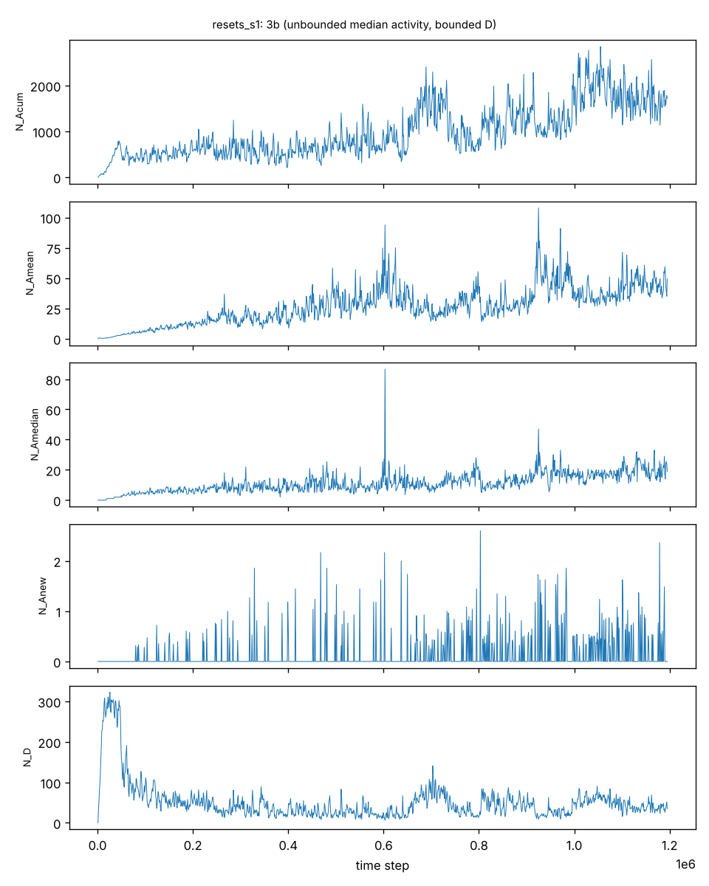
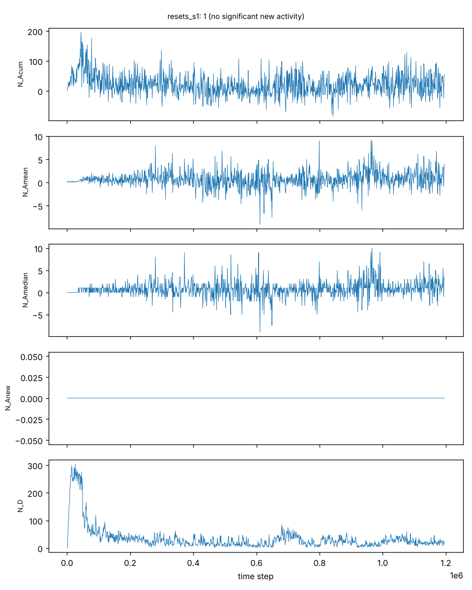

# M1 Results: Unbounded Evolutionary Activity in the Geb Port

## Summary
In three independent runs of the C++20 Geb port (seeds 1-3, about 1M time steps each),
Channon's component-normalised activity test (GPEM 2006 sections 8-9), with the paper's
component class (production-rule predecessor plus link bits), classifies the
dynamics as **Class 3b**:
- normalised median activity has a positive trend;
- diversity is bounded;
- normalised new activity is positive.

In each run, an independent second reset shadow analysed as if it were the real run
(the null control) classifies as **Class 1**. Its normalised median fluctuates around 0
and it has no adaptive new activity.

This qualitatively reproduces Channon's published result at about 1/6 of his run
length, and adds a null control that the original test did not have.

## Setup
- Simulator: `src/geb`, byte-exact with Geb v08b3 (`tests/golden`), 20x20 world,
  20-neuron limit, reset-shadow variant, rulestat snapshots every 1000 steps.
- Runs: `oee_geb_resets -seed S -stats -rulestat -second-shadow -presence presence`.
- Analysis: `tools/activity/report.py`; activity by presence in snapshot units;
  isolated-occurrence screening.
- Null: `-second-shadow` runs an independent random-selection shadow on its own RNG
  stream; it does not alter the real run (verified against golden data). It is reset
  to the real population at every snapshot, exactly like the first shadow.
- Classification rule (an operationalisation of GPEM Table I; "unbounded" cannot be
  proven on finite data). A statistic counts as unbounded when all three hold:
  - Mann-Kendall z > 2.58 on 20-snapshot block means over the second half;
  - positive Theil-Sen slope over the second half;
  - positive Theil-Sen slope over the last quarter.

## Results at about 1M steps (P+b grouping)

| run | population | last step | D | normalised median | MK z | median slope (per 1e6 steps) | normalised total | new activity >0 | class |
|---|---|---|---|---|---|---|---|---|---|
| seed 1 | real | 1195000 | 43.0 | 19 | 3.79 | 10.6 | 1719 | 0.26 | 3b |
| seed 1 | null | 1195000 | 23.8 | 4 | 3.79 | 0.0 | 55 | 0.00 | 1 |
| seed 2 | real | 1002000 | 45.6 | 12 | 3.81 | 2.5 | 1562 | 0.33 | 3b |
| seed 2 | null | 1002000 | 25.9 | 0 | 0.65 | 0.0 | 18 | 0.00 | 1 |
| seed 3 | real | 961000 | 43.4 | 16 | 4.74 | 20.0 | 1722 | 0.25 | 3b |
| seed 3 | null | 961000 | 22.7 | 0 | 0.45 | 0.0 | -13 | 0.00 | 1 |

Full table, including the whole-rule grouping and the independent-shadow run:
[results/m1/summary_1M.md](results/m1/summary_1M.md). Figures:
`results/m1/resets_s*_pb_{real,null}.png`.

## Caveats
1. **Run length.** About 1M steps against Channon's 6-8M. The trends are positive and
   consistent across seeds; whether they continue is an empirical question the
   ongoing runs address.
2. **The trend test alone is fragile.** For the seed-1 null, Mann-Kendall gives z = 3.79
   on a median that is flat at a low level (slope 0). It is excluded from Class 3 by the
   slope and new-activity criteria, not by the Mann-Kendall test. Classification relies
   on all criteria together.
3. **Component class matters.** With whole rules as components (what Geb's rulestat
   records), all runs classify as Class 2. This matches Channon's stated reason for
   using predecessor plus link bits: neutral variation in successors fragments rule
   identity. The paper's class is used for the headline result.
4. **Original (independent-shadow) test.** The classic Bedau-Packard comparison on the
   `no_resets` run is Class 2 at 1.29M steps (normalised median MK z = 1.98). Channon
   reported Class 3b at 6M steps.
5. **Population and genotype size.** Population is at most 400. Mean genotype length
   grows without bound (about 5500 genes at 1M steps), so throughput falls over time.
6. **GebR.** The random-selection variant (`-random-selection`) freezes at the
   20-agent minimum because nothing maintains reproduction. It is not a usable control;
   the second-shadow null replaces it.

## Next
- Continue the runs to 6M+ steps and re-run the report.
- Channon 2019 joint-scaling test (`-length`, `-neurons`) at reduced scale.
- Snapshot/resume, required for multi-day runs.
