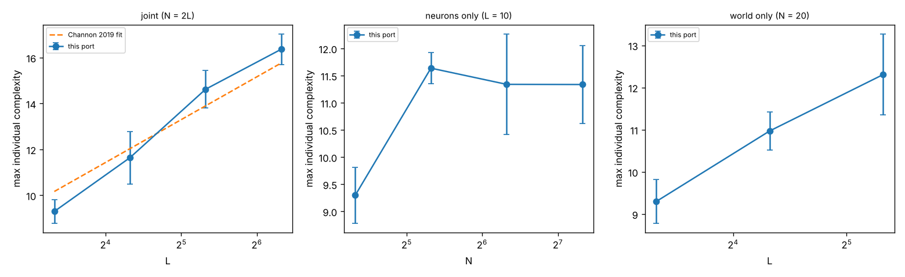

# Freeze Rescue and Channon (2019) Scaling Test

## 1. Freeze (stagnation) and its rescue

### Mechanism
Diagnosed with `tools/inspect_checkpoint` on frozen checkpoints:

- The population consists of agents whose outputs are saturated. They spin in place,
  or circle hexagons of a few cells, while isolated.
- No agent ever faces an occupied cell, so no reproduction or kill action can take
  effect.
- Geb has no other source of births. Once in this state, the run never leaves it.

Geb's rules were not changed. Instead, frozen runs are rescued by rollback and reseed.

### Rescue protocol
Implemented in `tools/supervise_runs.sh`, with simulator options `-archive-every`,
`-freeze-exit` and `-reseed`.

1. **Archive.** Every run writes a checkpoint archive every 250k steps.
2. **Detect.** The simulator exits with code 109 when no birth has occurred for 100k
   steps.
3. **Roll back.** The supervisor takes the newest archive at least 250k steps before
   the last birth, and resumes from it on a new RNG stream (reseed = seed·1000 + n).
4. **Fall back.** If two branches from the same archive both refreeze, the next older
   archive is used.
5. **Record.** Every rescue is logged to `<run>/rescues.txt`.
6. **Test.** `tests/check_rescue.sh` simulates a freeze and checks three things: the
   prefix up to the archive is unchanged, the branch after the reseed differs, and
   output files are truncated to the archive.

A rescued run is a single trajectory conditioned on not freezing. It is not a sample
of unconditioned Geb dynamics. Results from rescued runs are reported as such.

### Outcomes
| run | froze at (last birth) | rolled back to | reseed | afterwards |
|---|---|---|---|---|
| rescue_s1 (seed 1, 20x20, 20 neurons) | 2,677,676 | 2,250,000 | 1001 | reached 4M with no further freeze |
| scale_L10_N80_s15 | 788,611 | 500,000 | 15001 | reached 1M with no further freeze |

In the original M1 run, seed 1 was listed as stagnating at 2,799,900. That was a single
isolated late birth; the population had stopped reproducing at 2,677,676.

### Activity test on rescued seed 1 (to 4M)
Analysed with `tools/activity/report.py`, as in [RESULTS.md](RESULTS.md):

| grouping | population | normalised median (final) | MK z (2nd half) | D (2nd-half mean) | class |
|---|---|---|---|---|---|
| predecessor + link bits | real | 72 | 9.10 | 29.9 | 3b |
| predecessor + link bits | null | 11 | -1.72 | 13.8 | 2 |
| whole rule | real | 8 | 2.89 | 22.7 | 2 |

The real run's result agrees with seeds 2, 3 and 5 at 4M steps (smoothed medians 52-57;
see the trajectory table in RESULTS.md). The null stays bounded. After the rescue, the
seed-1 run is class 3b, as the seeds that never froze are.

## 2. Channon (2019) scaling test

Reference: Channon, "Maximum Individual Complexity is Indefinitely Scalable in Geb",
Artificial Life 25(2), 2019, doi:10.1162/artl_a_00285.

### Measure
Maximum individual complexity is Geb's own `max_used_component_count`. It counts the
genes involved in an agent's neural development, maximised over agents. It is logged
every 1000 steps.

For each run it is averaged over steps 0.5M-1M. The per-run values are then averaged
over the runs of each setting.

### Design (reduced)
- **Settings:** eight (world length L, neuron limit N) pairs:
  - joint scaling, N = 2L: (10, 20), (20, 40), (40, 80), (80, 160);
  - neurons only, L = 10: N = 20, 40, 80, 160;
  - world only, N = 20: L = 10, 20, 40.
- **Runs:** 5 seeds per setting (seeds 11-15), each 1M steps. (80, 160): 3 seeds (21-23),
  run to 3M in `runs3/`; the scaling row uses the same 0.5M-1M window.
- **(20, 20):** reuses the five M1 runs `resets_s1..5`, restricted to the same window.
- **Simulator:** reset-shadow variant, otherwise Geb v08b3 defaults.
- **Commands:** `oee_geb_resets -seed S -length L -neurons N -stats -rulestat`.
- **Analysis:** `tools/scaling/analyse.py`. Raw output is in
  [results/scaling/](results/scaling/).

The scale of this design is smaller than Channon's. Absolute values are not expected to
match his. What is compared is the shape of the result: whether complexity plateaus
when L or N is scaled alone, and whether it keeps increasing when both are scaled
together.

### Results
All 43 runs (36 scaling runs, three (80, 160) runs, plus the five M1 runs), window 0.5M-1M steps.

| L | N | runs | max individual complexity (mean) | 95% CI | Channon 2019 joint fit |
|---|---|---|---|---|---|
| 10 | 20 | 5 | 9.30 | ±0.52 | 10.17 |
| 10 | 40 | 5 | 11.64 | ±0.29 |  |
| 10 | 80 | 5 | 11.34 | ±0.93 |  |
| 10 | 160 | 5 | 11.34 | ±0.72 |  |
| 20 | 20 | 5 | 10.97 | ±0.46 |  |
| 20 | 40 | 5 | 11.64 | ±1.15 | 12.03 |
| 40 | 20 | 5 | 12.31 | ±0.96 |  |
| 40 | 80 | 5 | 14.62 | ±0.81 | 13.90 |
| 80 | 160 | 3 | 16.37 | ±0.66 | 15.77 |

Joint scaling fit (N = 2L): complexity = 9.33 + 2.46 log2(L/10), slope SE 0.15, R² 0.944, n 18 runs. Channon 2019: 10.17 + 1.87 log2(scale).
softmin model (all runs): complexity = 4.23 + 3.09 softmin(ln L, ln N), R² 0.840, n 43 runs.



### Interpretation
1. **Joint scaling (N = 2L): complexity keeps increasing.**
   - Fit: 9.33 + 2.46·log2(L/10). Slope SE 0.15; R² 0.94 over 18 runs and four scales.
   - L80/N160 (3 seeds): 16.37 ± 0.66, above L40/N80 (14.62). The previous three-scale fit
     (9.19 + 2.66·log2) predicted 17.17; the observed value is 0.8 below it, so growth is
     continuing but at a slightly lower rate. No plateau through L = 80.
   - Channon reports 10.17 + 1.87·log2(scale). The trend has the same form, roughly
     logarithmic growth with no sign of a plateau.
   - The slope here is steeper, about 3.9 standard errors above Channon's (it was 3.6 SE
     with three scales; the SE shrank more than the slope), and the
     intercept is lower. Likely cause: the short 1M-step window, in which smaller
     settings may not yet have reached their asymptote. This is not established.
2. **Neurons only (L = 10): plateau.**
   - Complexity rises from 9.30 (N = 20) to 11.64 (N = 40), then stays flat:
     11.34 at both N = 80 and N = 160.
   - The bottleneck moves to world size, as Channon reports.
3. **World only (N = 20): no plateau yet at L = 40.**
   - Complexity: 9.30 → 10.97 → 12.31 for L = 10, 20, 40.
   - This does not contradict the plateau prediction:
     - The softmin model (complexity = a + b·softmin(ln L, ln N)) still predicts growth
       at these settings, because softmin(ln 40, ln 20) = ln 13.3 lies well below ln 20.
     - A plateau should appear only for L ≫ N.
     - Fitted over all 43 runs: 4.23 + 3.09·softmin(ln L, ln N), R² 0.84.
   - Testing the world-only plateau directly needs L ≥ 80 at N = 20.

Summary: Channon's main 2019 result is reproduced qualitatively — complexity keeps
increasing when world size and neuron limit are scaled together, and saturates when the
neuron limit is scaled alone. The world-only plateau was outside the range tested.

Conditioning: one scaling run (L10_N80_s15) was rescued once, at 788,611 steps,
rolled back to 500,000 (the start of the measurement window). The other 35 new runs
never froze within 1M steps.

## Reproduce
```
tools/supervise_runs.sh runs2 build 60        # runs2/runs.txt lists the 36 runs
python3 -I tools/scaling/analyse.py out runs/resets_s{1..5} runs2/scale_* runs3/scale_L80_N160_s2{1,2,3}
python3 -I tools/activity/report.py out runs2/rescue_s1
```
